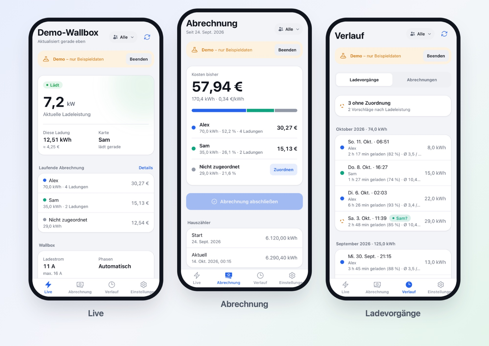
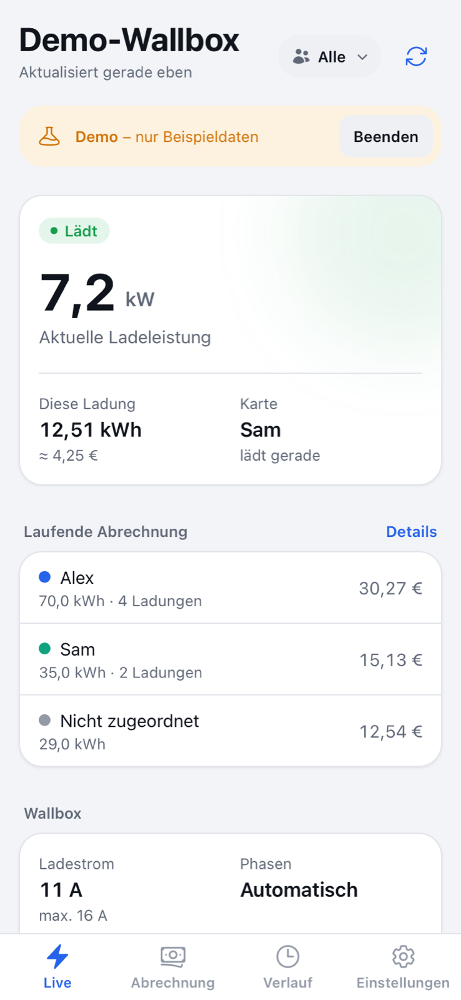
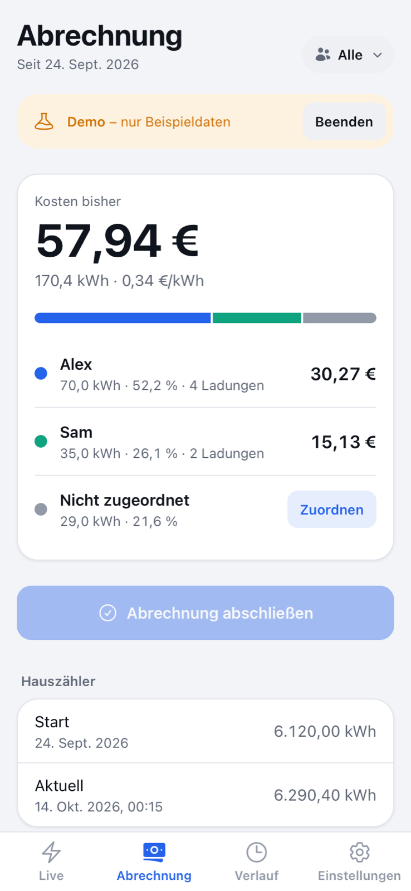
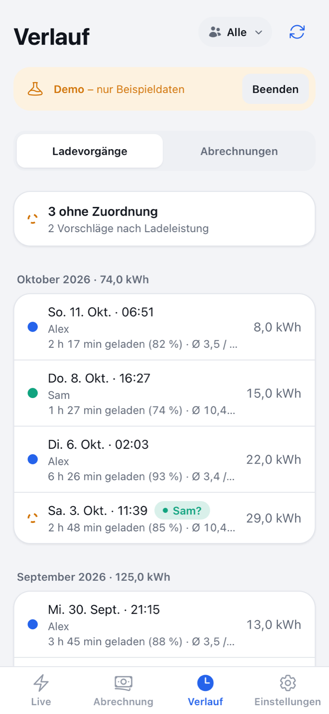
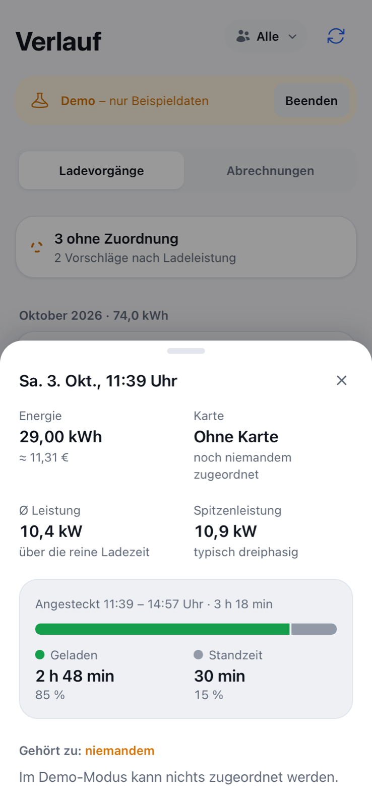
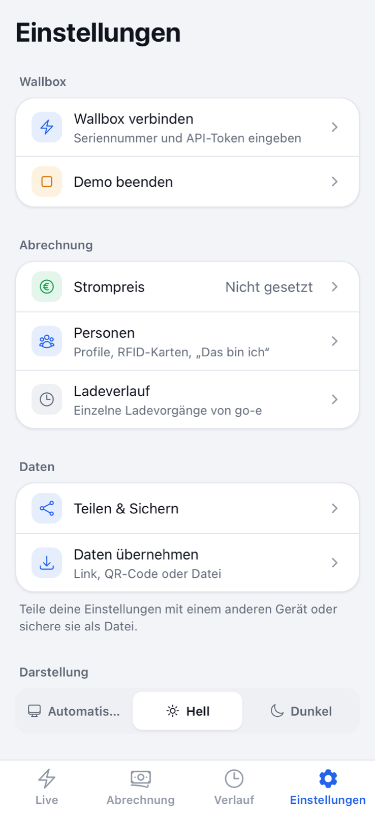
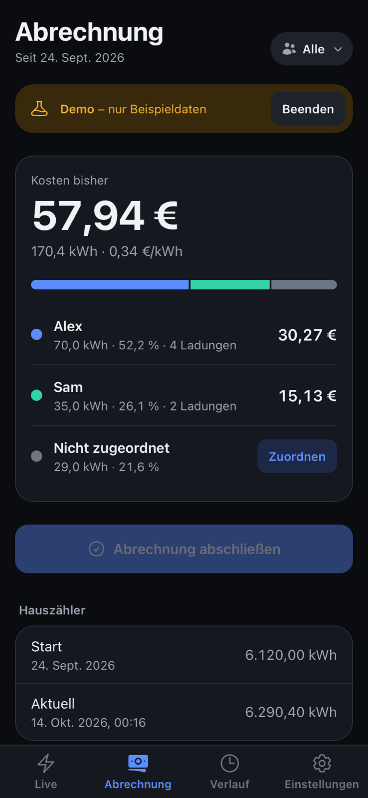
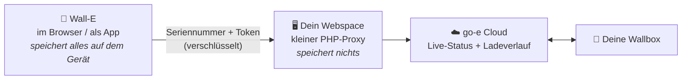

# Wall-E ⚡ – Stromkosten der go-e Wallbox fair aufteilen

<p align="center">
  
</p>

<p align="center">
  <b>Wer hat wie viel geladen – und was kostet das?</b><br>
  Wall-E zeigt live, was deine go-e Wallbox gerade macht, listet jeden Ladevorgang auf
  und rechnet aus, wer welchen Anteil an der Stromrechnung zahlt.<br>
  Fürs Handy gebaut, ohne Konto, ohne Datenbank, ohne Tracking.
</p>

<p align="center">
  <a href="LICENSE"></a>
  
  
</p>

---

## Inhalt

- [Worum geht es?](#worum-geht-es)
- [Was Wall-E kann](#was-wall-e-kann)
- [Kurz erklärt: die wichtigsten Begriffe](#kurz-erklärt-die-wichtigsten-begriffe)
- [So funktioniert es im Hintergrund](#so-funktioniert-es-im-hintergrund)
- [Einrichten in 5 Schritten](#einrichten-in-5-schritten)
- [Ohne Wallbox ausprobieren](#ohne-wallbox-ausprobieren)
- [Wie die Abrechnung rechnet – ein Beispiel](#wie-die-abrechnung-rechnet--ein-beispiel)
- [Deine Daten](#deine-daten)
- [Häufige Fragen](#häufige-fragen)
- [Für Entwickler](#für-entwickler)

---

## Worum geht es?

Eine Wallbox, mehrere Autos – zum Beispiel in der Familie, in einer WG oder bei Nachbarn mit gemeinsamem
Stromzähler. Am Monatsende stellt sich immer dieselbe Frage: **Wer muss wie viel von der Stromrechnung zahlen?**

Die go-e Wallbox weiß das eigentlich schon: Jedes Auto meldet sich mit einer eigenen **RFID-Karte** an, und die
Wallbox merkt sich jeden Ladevorgang. Wall-E holt diese Daten, rechnet sie in Euro um und zeigt sie übersichtlich an –
auch für Ladungen, bei denen jemand vergessen hat, die Karte vorzuhalten.

## Was Wall-E kann

<table>
  <tr>
    <td width="33%" align="center"></td>
    <td width="33%" align="center"></td>
    <td width="33%" align="center"></td>
  </tr>
  <tr>
    <td valign="top"><b>Live</b><br>Lädt gerade jemand? Mit wie viel Leistung, mit welcher Karte, und was kostet die aktuelle Ladung bisher?</td>
    <td valign="top"><b>Abrechnung</b><br>Kosten pro Person seit der letzten Abrechnung – mit Farbbalken. Am Monatsende „Abrechnung abschließen“, fertig.</td>
    <td valign="top"><b>Ladevorgänge</b><br>Jede einzelne Ladung mit Datum, Dauer und Energie. Ladungen ohne Karte sind markiert und lassen sich zuordnen.</td>
  </tr>
  <tr>
    <td width="33%" align="center"></td>
    <td width="33%" align="center"></td>
    <td width="33%" align="center"></td>
  </tr>
  <tr>
    <td valign="top"><b>Ladevorgang im Detail</b><br>Wie lange war das Auto angesteckt, wie lange wurde wirklich geladen (Standzeit vs. Ladezeit), mit welcher Leistung?</td>
    <td valign="top"><b>Einstellungen</b><br>Wallbox verbinden, Strompreis, Personen, Teilen & Sichern, Design, Kiosk-Ansicht fürs Wand-Tablet.</td>
    <td valign="top"><b>Hell & Dunkel</b><br>Folgt automatisch dem Handy – oder fest einstellbar.</td>
  </tr>
</table>

**Außerdem:**

- 👥 **Personen** – ein Profil kann mehrere RFID-Karten haben (z. B. Karte + Schlüsselanhänger). Jedes Handy kann
  „Das bin ich“ festlegen und zeigt dann direkt die eigenen Zahlen.
- ✨ **Zuordnungs-Vorschläge** – lädt ein Auto immer einphasig (≈ 3,7 kW) und das andere dreiphasig (≈ 11 kW),
  erkennt Wall-E an der Ladeleistung, wem eine Ladung ohne Karte vermutlich gehört. Du bestätigst nur noch.
- 🔗 **Teilen & Sichern** – Einstellungen per Link, QR-Code oder Datei aufs nächste Handy bringen; Sicherung als Datei.
- 📱 **Als App installierbar** – auf den Home-Bildschirm legen, startet dann wie eine normale App.

## Kurz erklärt: die wichtigsten Begriffe

| Begriff | Was ist das? |
|---|---|
| **go-e Wallbox** | Eine Ladestation fürs E-Auto (go-e Charger Gemini, HOMEfix, HOME+ usw.). Sie hängt im WLAN und kann über das Internet abgefragt werden. |
| **RFID-Karte** | Eine kleine Karte oder ein Schlüsselanhänger, den man vor die Wallbox hält, bevor man lädt. So weiß die Wallbox, *wer* lädt. |
| **Cloud-API und API-Token** | Die „Schnittstelle“, über die Programme wie Wall-E die Daten der Wallbox lesen dürfen. Der **Token** ist dabei wie ein Passwort – du findest ihn in der go-e App. |
| **Ladevorgang** | Alles vom Einstecken bis zum Abstecken. Davon ist ein Teil **Ladezeit** (es fließt Strom) und der Rest **Standzeit** (Auto hängt dran, ist aber schon voll oder wartet). |
| **kW und kWh** | kW (Kilowatt) = wie *schnell* geladen wird. kWh (Kilowattstunden) = wie *viel* Energie geladen wurde – danach wird bezahlt. |
| **Hauszähler** | Der Stromzähler, über den die Wallbox läuft. Er ist die Grundlage der echten Stromrechnung. |
| **Ladeverlust** | Beim Laden geht etwas Energie als Wärme verloren. Der Hauszähler misst deshalb ein paar Prozent mehr als die Wallbox. Wall-E rechnet das fair mit ein. |
| **PWA** | „Progressive Web App“ – eine Webseite, die sich wie eine App installieren lässt. Kein App Store nötig. |

## So funktioniert es im Hintergrund



- **Warum ein Proxy?** Browser dürfen aus Sicherheitsgründen nicht direkt mit der go-e Cloud sprechen (Stichwort CORS).
  Ein winziges PHP-Skript auf deinem Webspace reicht die Anfrage weiter – mehr nicht.
- **Was wird wo gespeichert?** Wallbox-Zugang, Strompreise, Personen und Abrechnungen liegen nur im Speicher deines
  Browsers. Es gibt keine Datenbank und kein Konto. Der Proxy speichert nichts.
- **Woher kommen die einzelnen Ladevorgänge?** Aus dem Ladeverlauf, den go-e ohnehin für dich führt (derselbe, den du in der
  go-e App exportieren kannst). Den nötigen Link liefert die Wallbox automatisch mit.

## Einrichten in 5 Schritten

Du brauchst:

- ✅ eine go-e Wallbox mit Internet (Firmware 052 oder neuer)
- ✅ einen Webspace mit **PHP 8** und **Apache** (bei fast jedem Hosting-Paket dabei) und HTTPS
- ✅ einmalig einen Computer mit **[Node.js](https://nodejs.org/) 20+**, um die App zu bauen

### 1. Cloud-API in der go-e App einschalten

Öffne die **go-e App** → wähle deine Wallbox → **Internet** → **Erweiterte Einstellungen** → **Cloud-API** einschalten.
Notiere dir den **API-Token** und die **Seriennummer** (steht ebenfalls in der App und auf dem Gerät).

> Die Menüs können je nach App-Version leicht anders heißen – gesucht ist der Schalter „Cloud-API“.

### 2. Code herunterladen und bauen

```sh
git clone https://github.com/flexi03/wall-e.git
cd wall-e
npm install          # lädt die benötigten Bausteine (einmalig)
npm run build        # erzeugt die fertige App im Ordner dist/
```

Optional: `cp site.config.example.js site.config.js` und dort Kontakt, Impressum und Datenschutz-Link eintragen.
Sie erscheinen dann in der App unter „Hilfe & Datenschutz“.

### 3. Auf den Webspace hochladen

Lade den **Inhalt** von `dist/` und von `server/` zusammen in das Hauptverzeichnis einer (Sub-)Domain,
z. B. `wallbox.deine-domain.de`. Danach sieht es auf dem Server so aus:

```
/                       ← Hauptverzeichnis der Domain
├── index.html          ┐
├── manifest.json       │  aus dist/
├── .htaccess           │  (HTTPS, Sicherheit, App-Navigation)
├── assets/…            ┘
└── api/
    ├── status.php      ┐
    ├── test.php        │  aus server/api/
    ├── history.php     │  (der kleine Proxy)
    ├── goe.php         │
    └── .htaccess       ┘
```

> Wichtig: Auch die versteckte Datei `.htaccess` mit hochladen – manche FTP-Programme blenden sie aus.

### 4. Öffnen und Wallbox verbinden

Rufe die Adresse auf dem Handy auf → **Wallbox verbinden** → Seriennummer und Token eintragen →
**Verbindung testen** → **Verbinden**. Fertig – Live-Status und Ladevorgänge erscheinen nach wenigen Sekunden.

### 5. Als App auf den Home-Bildschirm

| iPhone / iPad (Safari) | Android (Chrome) |
|---|---|
| **Teilen** (Quadrat mit Pfeil) → **Zum Home-Bildschirm** → **Hinzufügen** | Menü **⋮** → **App installieren** (oder in Wall-E: Einstellungen → Als App installieren) |

> iPhone-Hinweis: Die installierte App hat einen eigenen Speicher, getrennt von Safari.
> Hast du vorher in Safari eingerichtet, übertrage die Daten mit **Einstellungen → Teilen & Sichern**.

## Ohne Wallbox ausprobieren

Auf der Startseite **„Demo ansehen“** tippen. Wall-E zeigt dann Beispieldaten (Personen „Alex“ und „Sam“) –
deine echten Einstellungen bleiben dabei unberührt. Für den Demo-Modus braucht es keinen Server-Teil:
`npm run dev` reicht.

## Wie die Abrechnung rechnet – ein Beispiel

Seit dem letzten Abschluss hat …

| | geladen (Wallbox) | Anteil |
|---|---|---|
| Alex | 70 kWh | 70 % |
| Sam | 30 kWh | 30 % |
| **Wallbox gesamt** | **100 kWh** | |

Der **Hauszähler** ist in derselben Zeit aber um **108 kWh** gestiegen – 8 % gingen beim Laden als Wärme verloren.
Bei einem Strompreis von **0,35 €/kWh** kostet das insgesamt 108 × 0,35 = **37,80 €**, aufgeteilt nach Anteil:

| | Kosten |
|---|---|
| Alex | 70 % von 37,80 € = **26,46 €** |
| Sam | 30 % von 37,80 € = **11,34 €** |

Trägst du keinen Hauszählerstand ein, rechnet Wall-E pauschal mit 1,8 % Ladeverlust.
Ladungen ohne Karte stehen entweder als eigene Zeile „Nicht zugeordnet“ da oder werden anteilig verteilt –
das stellst du auf der Abrechnungsseite ein. Mit **„Abrechnung abschließen“** wird der Stand gespeichert und
die nächste Abrechnung beginnt bei null; alle alten Abrechnungen findest du im Verlauf.

## Deine Daten

- **Alles bleibt auf deinem Gerät** (im Speicher des Browsers). Wall-E hat kein Konto, keine Datenbank, keine Cookies,
  kein Tracking und lädt nichts von fremden Servern.
- **Teilen** passiert nur, wenn du es willst: Der Link enthält die Daten selbst (hinter dem `#`, das wird nie an
  einen Server geschickt), die Datei ist eine normale JSON-Datei. Enthält das Geteilte deinen API-Token, warnt Wall-E.
- **Sicherung:** Einstellungen → Teilen & Sichern → *Als Datei sichern*. Ein Import lässt sich rückgängig machen.
- **Der Proxy** nimmt nur POST-Anfragen an, prüft Seriennummer und Token streng und leitet ausschließlich an go-e weiter.
  Fremde Webseiten können seine Antworten im Browser nicht lesen. Seriennummer und Token stehen nie in einer URL und
  landen so nicht in Server-Logs.

## Häufige Fragen

<details>
<summary><b>„Wallbox nicht erreichbar“ – was tun?</b></summary>

Prüfe Seriennummer und Token und ob die **Cloud-API** in der go-e App eingeschaltet ist. Kurze Aussetzer der go-e Cloud
überbrückt Wall-E selbst (es versucht es still erneut und zeigt solange den letzten Stand).
</details>

<details>
<summary><b>Warum sind manche Ladevorgänge „ohne Zuordnung“?</b></summary>

Dann wurde ohne RFID-Karte geladen. Tippe den Ladevorgang an und wähle die Person – oder übernimm die Vorschläge,
die Wall-E anhand der Ladeleistung macht. Trag dafür unter **Einstellungen → Personen** die Ladeleistung der Autos ein
(z. B. 3,7 kW oder 11 kW) – oder lass Wall-E sie aus bisherigen Ladungen lernen.
</details>

<details>
<summary><b>Brauche ich den Hauszählerstand?</b></summary>

Nein, aber er macht die Abrechnung genauer, weil dann der echte Ladeverlust eingerechnet wird.
Einfach ab und zu unter **Abrechnung → Hauszähler → Aktuell** eintragen.
</details>

<details>
<summary><b>Wie bringe ich alles auf ein neues Handy?</b></summary>

Altes Handy: **Einstellungen → Teilen & Sichern** → Link teilen, QR-Code zeigen oder als Datei sichern.
Neues Handy: Link öffnen bzw. **Einstellungen → Daten übernehmen**.
</details>

<details>
<summary><b>Funktioniert das mit anderen Wallboxen?</b></summary>

Nein, Wall-E nutzt die Schnittstellen von go-e. Die Rechen-Logik (`src/lib/`) ist aber unabhängig davon und
lässt sich für andere Hersteller wiederverwenden.
</details>

## Für Entwickler

```sh
npm install
npm run dev -- --host    # http://localhost:5173 (auch im WLAN fürs Handy)
npm test                 # Unit-Tests (Abrechnung, Kompatibilität, Personen, Teilen …)
npm run build
```

- Für echte Daten bei `npm run dev`: in `site.config.js` bei `devApiTarget` die Adresse einer laufenden Installation
  eintragen – Vite leitet `/api` dorthin weiter.
- `/devices.html` (nur im Entwicklungsmodus) zeigt die App gleichzeitig in Handy-, Tablet- und Laptop-Größe.
- Aufbau und Regeln: [`AGENT.md`](AGENT.md) · Design-System: [`docs/DESIGN.md`](docs/DESIGN.md) ·
  gespeicherte Daten und Rechenwege: [`docs/DATA.md`](docs/DATA.md) · Änderungen: [`CHANGELOG.md`](CHANGELOG.md)
- Technik: React 18, React Router, Tailwind CSS, Vite, Vitest; Server-Teil in schlichtem PHP ohne Abhängigkeiten.

## Lizenz

[MIT](LICENSE) – frei nutzbar, auch kommerziell; bitte den Lizenzhinweis beibehalten.

Wall-E ist ein privates Projekt und nicht mit der go-e GmbH verbunden. „go-e“ ist eine Marke der go-e GmbH.
